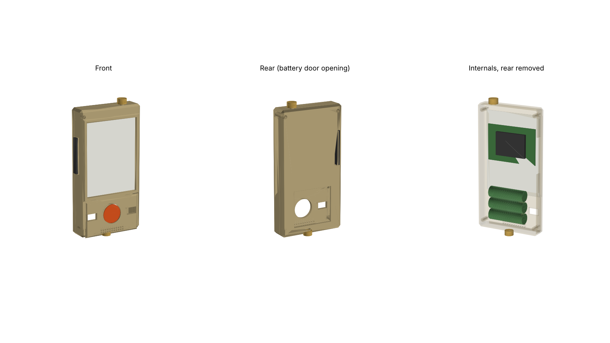

# S-01

S-01 is a design for a rugged, offline handheld that answers survival questions.
A small language model runs entirely on the device and answers only from a curated,
cited reference library: first aid, water, fire, shelter and navigation, plus
regional packs for local plants, animals and hazards. It is meant to sit in a go bag,
charge from solar or a hand crank, and keep working for 20 years.

This is a personal, non-commercial hobby project.

## Status

Early prototype, as of November 2026.

- **Software:** a working laptop emulator of the device. It has safety routing,
  library search, cited answers from a local model through Ollama, and a
  library-only fallback mode. Screens are drawn at 6" e-ink resolution. Hardware
  drivers for a Raspberry Pi are sketched and untested. Voice is not built yet.
- **Hardware:** a parametric starter CAD model of the enclosure and internal layout.
  No physical prototype has been built.
- **Library:** five sample documents and five emergency cards. All of it is
  paraphrased placeholder text marked `vetted: false`. **Do not rely on it for real
  medical or survival decisions.**

## Repository layout

| Path | What it is |
|------|------------|
| `software/` | Emulator, answer pipeline, sample library and emergency cards |
| `hardware/enclosure/` | build123d CAD model, collision check, preview render |
| `INVENTORY.md` | Every component, with dates |

## Run the software

Requires Python 3.10+ with Tk.

    cd software
    pip install -r requirements.txt
    python ask.py "how do I treat stream water"   # quick test, no window
    python run_emulator.py --no-model             # device window, library-only mode

For AI-written answers, install [Ollama](https://ollama.com), run
`ollama pull gemma3:1b`, then `python run_emulator.py`. The model is downloaded
separately under its own license and isn't included here.
See `software/README.md` for controls and details.

## Build the enclosure model

    cd hardware/enclosure
    pip install build123d matplotlib
    python s01_enclosure.py   # writes s01_assembly.step and two STL halves
    python check.py           # checks that parts don't collide with the housing
    python render.py          # writes s01_preview.png

## Acknowledgments

Partially inspired by [CrankGPT](https://squeezlabs.github.io/handcrank) from Squeez Labs, a
hand-crank-powered offline voice assistant on a Raspberry Pi 5. S-01 doesn't use any
CrankGPT code.

## License

MIT. See `LICENSE`.
